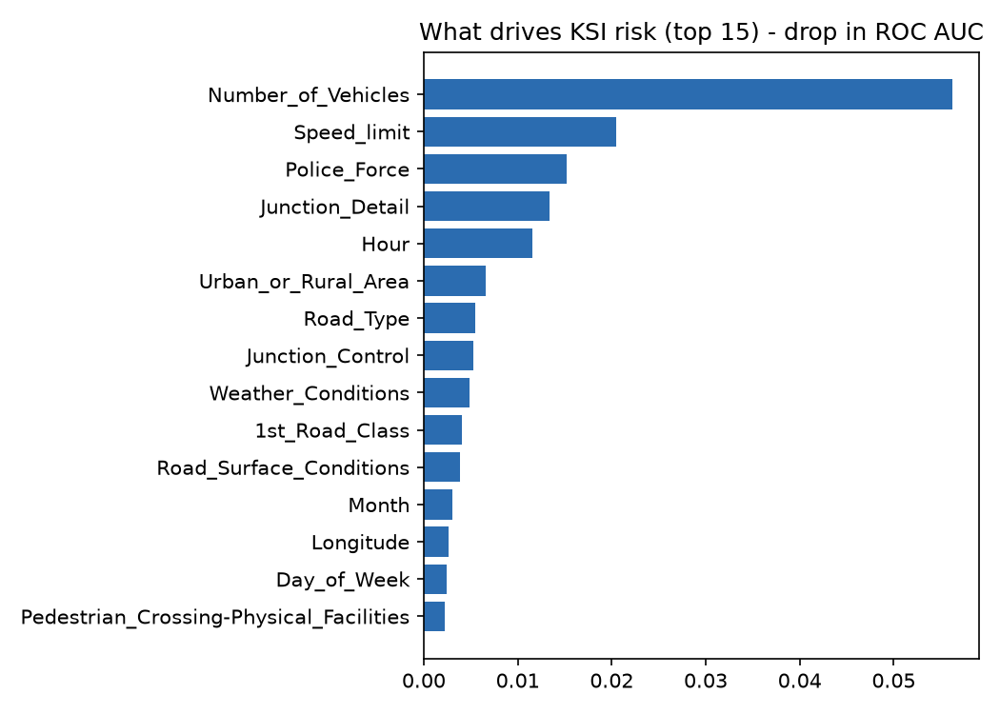
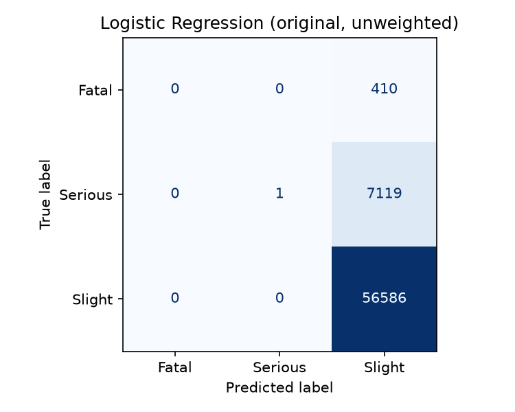
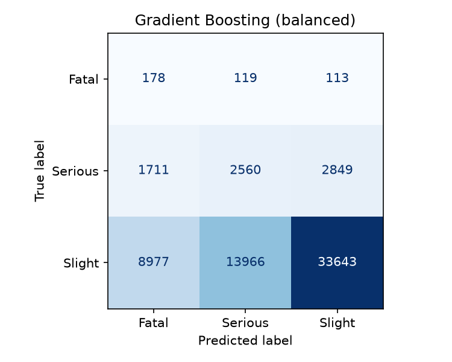
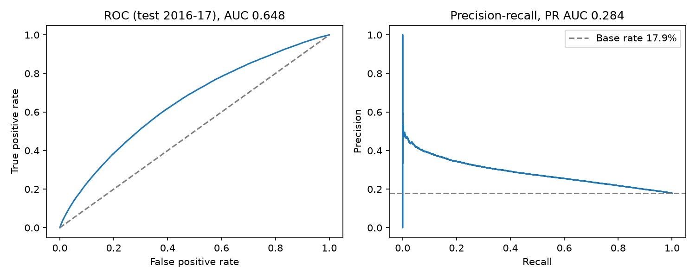

# Road Accident Severity: what makes a crash serious?

Predicting whether a road accident in Great Britain killed or seriously injured someone (**KSI**), using 2 million police accident records (STATS19, 2005–2017).

**Original MSc Data Analytics project (London Metropolitan University, 2024), rebuilt in 2026.**

---

## The short version

- My first model in 2024 scored **88% accuracy**. When I went back to it, I found it was predicting "Slight" for *every* accident. 88% of accidents are slight, so it scored 88% while missing every fatal and serious case.
- I rebuilt it twice:
  1. **v1 fix (London, 3 classes):** class weighting and gradient boosting. It now catches **43% of fatal** and **36% of serious** accidents (was 0%).
  2. **v2 (all of Great Britain, KSI):** trained on 2005–2014 and tested on 2016–2017, years it never saw. **ROC AUC 0.65.** It catches **49% of KSI accidents**, and its riskiest 10% of accidents are **1.9× more likely** to be serious.
- There's also an interactive **risk explorer app** ([app.py](app.py)).

## Key findings

From a 20,000-accident sample of the 2016–2017 test data:

| Condition | Share of accidents that were serious or fatal |
| --- | --- |
| Daylight | 16.9% |
| Darkness, **no street lighting** | **27.5%** |
| Urban roads | 15.6% |
| **Rural roads** | **21.4%** |
| 30 mph roads | 15.6% |
| **60 mph roads** | **26.0%** |
| 70 mph (mostly motorways) | 17.7% |

Unlit rural roads at 60 mph are where accidents are most likely to be serious. Motorways are faster but safer, because they're designed for speed: no junctions, no oncoming traffic.



## Part 1: what went wrong in 2024

The original model (London, 320,580 accidents, 3 classes: Fatal / Serious / Slight):

| Model | Accuracy | Balanced accuracy | Finds fatal | Finds serious |
| --- | --- | --- | --- | --- |
| Always guess "Slight" | 88.3% | 33.3% | 0% | 0% |
| Original Logistic Regression (2024) | 88.3% | 33.3% | 0% | 0% |
| Logistic Regression, balanced | 51.0% | 45.7% | 53.9% | 29.6% |
| **Gradient Boosting, balanced** | 56.7% | **46.3%** | **43.4%** | **36.0%** |

Three things caused it:
1. **Class imbalance.** With 88% slight accidents, a model can look good by ignoring the rare classes.
2. **Wrong encoding.** Categories like weather were turned into numbers 0, 1, 2…, which tells the model that "Rain" is bigger than "Fine".
3. **Wrong metric.** Accuracy hides the problem. Balanced accuracy and per-class recall show it.

Accuracy goes *down* after the fix, and that's the point: the model now flags risky accidents instead of playing it safe.

| Original (2024) | Rebuilt |
| --- | --- |
|  |  |

Code: [rebuild_model.py](rebuild_model.py)

## Part 2: v2 model (2026)

| Choice | Why |
| --- | --- |
| Target: **KSI** vs slight | The UK Department for Transport's own headline measure. Simpler and more useful than 3 classes. |
| Data: **all of Great Britain** | 2,047,014 accidents instead of London only. |
| **Time-based split** | Train 2005–2014, tune on 2015, test on 2016–2017. That's how the model would be used in real life. |
| **Gradient-boosted trees** (scikit-learn HistGradientBoosting, the LightGBM family) | Handles categories natively and captures interactions like "dark + rural + 60 mph". |
| **Class weighting + tuned threshold** | The threshold is chosen on 2015 data, not left at 0.5. |
| **Leakage check** | Dropped "did a police officer attend", because police attend more often *because* an accident is serious. |

### Results

| Set | Accidents | KSI rate | ROC AUC | PR AUC | Recall | Precision | Lift (top 10%) |
| --- | --- | --- | --- | --- | --- | --- | --- |
| Validation (2015) | 140,044 | 15.5% | 0.666 | 0.267 | 52.4% | 25.4% | 2.11× |
| **Test (2016–17)** | **266,535** | **17.9%** | **0.648** | **0.284** | **48.9%** | **27.4%** | **1.93×** |



**Does the risk score rank accidents correctly?** Yes. Splitting 20,000 test accidents into five equal risk bands, the share that were actually serious or fatal rises steadily:

| Risk band | Very low | Low | Medium | High | Very high |
| --- | --- | --- | --- | --- | --- |
| Actually KSI | 9.1% | 11.7% | 17.0% | 20.6% | **29.7%** |

### Honest limits

- **ROC AUC 0.65 is modest.** Road, weather, light and time explain only part of severity. The model doesn't know who was involved (a motorbike, a cyclist, a lorry, a young driver), which matters a lot. Adding vehicle data is the obvious next step.
- **The KSI rate jumps in 2016–17 (17.9% vs 15.5%).** UK police forces began moving to a new injury-reporting system around 2016, which records more injuries as serious. Part of the jump is a reporting change, not more dangerous roads.
- **Scores are relative risk, not exact probabilities**, because of class weighting.

## Risk explorer app

Pick the speed limit, area, light, weather and road type, and see the risk compared with an average accident.

```bash
pip install -r requirements.txt
streamlit run app.py
```

## Also in the original project

- **Power BI dashboard:** the 2024 original was multi-page with 15+ visuals and borough-level drill-down. The 2026 version is [powerbi/Road_Accident_Dashboard.pbix](powerbi/Road_Accident_Dashboard.pbix), built from the tables in [powerbi/data](powerbi/data) with this [build guide](powerbi/BUILD_GUIDE.md).
- **ARIMA forecast in R:** the 2024 dissertation projected London accident counts to 2027 and reported a MAPE of 0.92%. In 2026 I found that the yearly counts had been passed to the model out of year order, and that the error was measured on the data the model was fitted to. With the years in order the same model's error is about 3.7%, and the falling trend it showed was not in the data. I don't rely on that forecast.

## Run it yourself

1. Download `Accident_Information.csv` from the Kaggle dataset *"UK Road Safety: Traffic Accidents and Vehicles"* (STATS19 data, Department for Transport, Open Government Licence) into `data/`.
2. Run:
```bash
pip install -r requirements.txt
python rebuild_model.py data/Accident_Information.csv     # Part 1
python src/train_v2.py data/Accident_Information.csv      # Part 2
python src/explain_v2.py                                  # Feature importance
```

## Tools

Python · pandas · scikit-learn · matplotlib · Streamlit · Power BI · R (ARIMA)

---
Data Analyst (BI & AI Automation) · [LinkedIn](https://www.linkedin.com/in/abdullahashrf) · [Portfolio](https://abdullahashrf.vercel.app) · Related: [London Fly-Tipping](https://github.com/abdullah-ashrf/london-fly-tipping)
